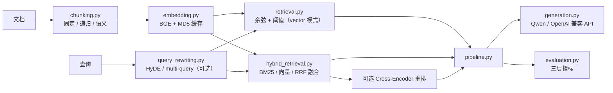

# rag-eval-platform 架构与设计决策

> 本文面向公开仓库读者，说明模块边界、数据流、评测口径与关键取舍。

## 1. 定位

一个可复现的 RAG 实验平台：把「切分 → 向量化 → 检索 → 生成 → 评测」拆成可独立替换的模块，
每个环节都能单独度量，并用对照实验回答问题——而不是只做一个「能问答」的 demo。

## 2. 模块图

## 3. 数据流

### 3.1 建库

1. `DocumentChunker` 按策略切分；分配**全局唯一** `chunk_index`（跨文档连续），文档内序号保留为 `doc_chunk_index`。
   —— 每个文档各自从 0 编号会造成跨文档索引重复，检索结果无法唯一标识。
2. `EmbeddingEngine` 用 BGE-small-zh-v1.5（512 维）编码；以文本 MD5 作为缓存键，内容不变不重算。
3. `RAGPipeline.build_index` 在 bm25/hybrid 模式下同步拟合 BM25 语料（vector 模式不付这份成本）。

### 3.2 问答

1. （可选）`QueryRewriter` 对 query 做 HyDE / multi-query 改写，得到「原查询 + N 条变体（+ 假想文档）」；
2. 编码 + 检索：
   - `vector`：余弦相似度 + `similarity_threshold` 过滤；
   - `bm25`：Okapi BM25 排序（只返回命中文档）；
   - `hybrid`：向量全量排名 + BM25 排名 → RRF →（可选）Cross-Encoder 重排；
   - 改写开启时：各路查询分别召回 → RRF 融合多路排名；
3. `GenerationEngine` 拼接 RAG Prompt 生成；
4. 返回 `answer` 与 `retrieved_docs`（含 `score` 向量余弦 / `bm25_score` / `fusion_score` /
   `vector_rank` / `bm25_rank` / `rerank_score` / `source` / `chunk_index`）。

### 3.3 评测

1. 检索层：文档级 Recall@3 / Recall@5 / Precision@3 / MRR；
2. 生成层：LLM-as-Judge（faithfulness / relevance / completeness）；
3. 传统层：BLEU / ROUGE-L。

## 4. 检索模式

三种排名口径共用同一套候选与结果结构（`rank_mode` 切换），便于做「只换排序依据」的对照实验：

| mode | 排序依据 | 特点 |
|---|---|---|
| `vector`（默认） | 向量余弦 + 阈值过滤 | 语义相似；对精确术语/近义副本不敏感；零额外成本 |
| `bm25` | Okapi BM25 | 关键词精确匹配；只返回真正命中的文档；微秒级 |
| `hybrid` | RRF(向量排名, BM25 排名) | 兼顾语义与关键词；可选叠加 Cross-Encoder 重排 |

结果里同时保留 `vector_rank` / `bm25_rank` / `fusion_score`，让「这条是谁捞上来的、融合后涨了还是跌了」可解释，
而不是只给一个黑箱分数（Web UI 会把这些列直接摊开展示）。

### 4.1 纯向量（默认）

- embedding 已归一化，点积等价于余弦；
- 低于阈值的候选直接丢弃（宁可不答，不喂噪音）；
- 零额外依赖，几十~几百 chunk 规模下足够。

### 4.2 混合检索

- **BM25**：Okapi BM25，纯 NumPy 实现。分词 = 英文/数字整词 + 中文单字 + 中文二元组（不引入 jieba）。
- **融合**：RRF（Reciprocal Rank Fusion），`score = Σ 1/(k + rank)`，默认 `k=60`。
- **为什么不用加权求和**：向量余弦 ∈ [-1,1]，BM25 分数无上界，两者量纲不同，直接相加没有意义；
  RRF 只依赖排名，对分数量纲不敏感。
- **开关**：`retrieval.mode: "vector" | "bm25" | "hybrid"`，默认 `vector`，保持历史行为零回归。
- **为什么默认不开**：BM25 一路本身几乎不花钱，但多一路就多一份维护与调参成本
  （分词、k1/b、rrf_k）；在干净小库上实测收益为 0，所以默认只在你明确需要时开。

### 4.3 重排（可选）

- 用 `CrossEncoder` 对 RRF 融合后的 top-N 做二次精排；重排分写回结果（`rerank_score`），排序变化可追溯。
- 默认关闭：模型体积与下载成本；加载失败会自动降级回 RRF（`rerank_load_error` 记录原因），不影响检索可用性。
- **默认走 CPU**：top-N（≤20）规模下 GPU 收益很小，而 CPU 不占用生成模型的显存，小显存机器也不易 OOM；
  可用 `retrieval.hybrid.rerank.device` 覆盖。
- **实测定位**（§6.3）：重排只在**排序还有提升空间**时有用——它提高 MRR、不提高召回；
  两个数据集上 R@3/R@5 都没变，MRR 分别 +0.0714 / +0.2292 到 1.0，代价是热 p50 增加约 75–995ms。

### 4.4 查询改写（HyDE / multi-query，可选）

- **multi-query**：把问题改写成 N 条不同角度的查询，各自召回后用 RRF 融合——任一路漏掉的文档，
  只要在其它路排得靠前就能被捞回来。
- **HyDE**：让 LLM 先生成一段「假想答案文档」，用**它的向量**再检索一路，缓解 query 与文档的表述 gap。
- **实现**：`src/query_rewriting.py`，LLM 以依赖注入方式传入（生产用 `GenerationEngine.complete`，
  单测用 stub），因此改写逻辑可离线确定性单测；LLM 报错/输出不可解析 → 退化为原查询，**绝不因改写失败而检索不可用**。
- **默认关闭**：改写要多跑 LLM 生成，把单次延迟从毫秒级推到秒级（实测热 p50 1.2–12.6s）；
  在干净小库上召回已接近天花板、收益有限。
- **实测提醒**（§6.3）：收益**依赖生成模型质量**——本次用 Qwen2.5-1.5B 时，HyDE 在噪声库上
  反而把 R@3 从 1.0 拉到 0.75（假想文档夹带泛化术语、把检索带偏）。所以它是**可选档**，不是默认路径；
  换更强的 LLM 需要重新实测再决定是否开启。

## 5. 评测口径

### 5.1 为什么用文档级

chunk 边界随切分策略/参数变化，chunk 索引无法跨策略对照；
「是否检索到正确文档」才是策略无关的稳定口径。
实现上把 chunk 级结果按 `source` 去重（保留原相关性排序，不相关文档占位但不命中），
再复用同一套 Recall / Precision / MRR 公式。

### 5.2 三层指标

| 层 | 指标 | 回答的问题 |
|---|---|---|
| 检索 | Recall@3/5、Precision@3、MRR | 该找到的文档找到了吗？排得靠前吗？ |
| 生成 | faithfulness / relevance / completeness | 回答有依据吗？切题吗？完整吗？ |
| 传统 | BLEU / ROUGE-L | 与参考答案的字面重合度 |

生成层口径补充（2026-10-19 实测后细化，数字见 §6.4）：

- **裁判选择**：`config.yaml` 的 `judge_model` 默认为**与生成模型同款**的 `Qwen2.5-1.5B-Instruct`（即自评）。
  实测表明这一档小模型当裁判**与强裁判几乎不相关**，正式评测应改用强模型 / API；本地 1.5B 裁判只适合两端粗筛或离线占位。
- **确定性替代**：`experiments/run_generation_eval.py` 的**规则判据臂**（数字/实体落地率、句子归因覆盖率、
  拒答判定、EM/F1/ROUGE-L/BLEU）零成本、离线可复现，实测比本地裁判更贴近强裁判，适合做回归门禁。
- **已知缺陷（已修复，2026-10-20）**：`evaluation.py::_judge_single_dim` 曾把 tokenizer 产出的 CPU 张量
  直接喂给 CUDA 上的裁判模型（缺设备搬运），异常又被 `try/except` 吞掉 → **静默退化成启发式打分**。
  现已改为在 `generate` 前把输入搬到 `model.device`，并且任何兜底都写进 `meta.fallbacks`（带维度与原因）、
  以 warning 日志点名、由报告层打印。验证：① 离线单测用假模型断言送进 `generate` 的张量都在 `model.device`；
  ② GPU 上真实对比「旧版 vs 修复后」（同模型同一样本）：旧版三维全部抛
  `Expected all tensors to be on the same device` 并返回启发式（`realistic#10` 得到 1/1/1），
  修复后同一批样本拿到真实裁判分（4/3/3），33 条样本重跑与修复前（绕过版）逐条一致、零兜底。详见 §6.4 附录。

## 6. 实验结果

### 6.1 混合检索对照（2026-10-18）

| 数据集 | 档位 | 平均 Recall@3 | 平均 MRR |
|---|---|---|---|
| realistic（14 篇，话题区分度大） | 纯向量 | 1.0 | 0.9286 |
| realistic | 混合 RRF | 1.0 | 0.9286 |
| near_dup_stress（10 篇，8 篇近义副本） | 纯向量 | 0.625 | 0.4792 |
| near_dup_stress | 混合 RRF | **1.0** | **0.7708** |

结论：混合检索的收益取决于语料。干净小库上强向量模型已接近上限，收益有限；
在含近义/重复文档的噪声语料上，BM25 的精确匹配能纠正向量把分数分散到副本的问题。

复现：`python experiments/run_hybrid_comparison.py`
（报告落 `experiments/results/hybrid_comparison_<date>.md`）。

### 6.2 切分策略对照（2026-10-16）

5 篇文档的样例集上，三种策略与各 chunk_size 的文档级 Recall@3 均为 1.0（数据集太小导致的天花板效应）；
报告见 `experiments/results/strategy_comparison_2026-10-16.md`，其中如实标注了适用边界。

### 6.3 检索全档位基准：质量 + 延迟（2026-10-19）

复现：`python experiments/run_retrieval_benchmark.py`
（离线可跑；报告落 `experiments/results/retrieval_benchmark_2026-10-19.md` + `.json`）。

口径：单机 RTX 5060 Laptop（8GB）/ torch 2.14.0+cu132；延迟只算 `_retrieve`（改写 + 编码 + 检索 + 重排），
**不含生成回答**；冷启动 = 切档位后第一次查询（含懒加载 + CUDA 预热），热启动 = 之后所有查询的 p50/p95。
embedding 与改写 LLM 走 GPU，**重排走 CPU**。

**A. `realistic`（14 篇 / 14 题，话题区分度大）**

| 档位 | R@3 | R@5 | MRR | 冷 ms | 热 p50 | 热 p95 |
|---|---|---|---|---|---|---|
| 纯向量 | 1.0 | 1.0 | 0.9286 | 1.2 | 0.62 | 1.06 |
| 纯 BM25 | 1.0 | 1.0 | 0.8929 | 2.44 | 2.07 | 3.35 |
| 混合 RRF | 1.0 | 1.0 | 0.9286 | 2.15 | 2.38 | 3.38 |
| 混合 + 重排 | 1.0 | 1.0 | **1.0** | 665.1 | 994.7 | 1118.9 |
| 混合 + multi-query | 1.0 | 1.0 | 0.9524 | 3580.2 | 1609.7 | 2785.2 |
| 混合 + HyDE | 1.0 | 1.0 | 0.9286 | 11329.3 | 12630.1 | 15712.4 |

**B. `near_dup_stress`（10 篇 / 8 题，含 8 篇近义副本）**

| 档位 | R@3 | R@5 | MRR | 冷 ms | 热 p50 | 热 p95 |
|---|---|---|---|---|---|---|
| 纯向量 | 0.625 | 0.625 | 0.4792 | 0.88 | 0.4 | 0.85 |
| 纯 BM25 | **1.0** | **1.0** | **1.0** | 0.44 | 0.46 | 0.73 |
| 混合 RRF | **1.0** | **1.0** | 0.7708 | 0.6 | 0.43 | 1.1 |
| 混合 + 重排 | **1.0** | **1.0** | **1.0** | 641.0 | 74.3 | 76.6 |
| 混合 + multi-query | **1.0** | **1.0** | 0.8333 | 1601.6 | 1198.9 | 1374.9 |
| 混合 + HyDE | 0.75 | **1.0** | 0.7375 | 4977.4 | 5569.1 | 7973.5 |

**结论（含对本方案不利的实测）**

1. **干净小库上向量已到天花板**：R@3 已 1.0，混合 / 重排 / 改写都**提不了召回**，只能改排序；
   代价却是热 p50 从 2.4ms 涨到 1.0s（重排）/ 1.6s（multi-query）。
2. **噪声库才是收益区间**：混合把 R@3 从 0.625 拉到 1.0（+37.5 个百分点）、MRR 0.4792 → 0.7708。
3. **混合不是无脑更好**：stress 集上**纯 BM25 的 MRR(1.0) 高于混合(0.7708)**——纯标识符查询（"QTAG-A1"）
   单路精确匹配已是最优，融合会被向量那一路的整体排名稀释。该场景应直接选 `bm25`。
4. **HyDE 在本次设置下掉点**：噪声库 R@3 1.0 → 0.75、MRR → 0.7375，热 p50 5.6s（×13000）。
   1.5B 小模型生成的假想文档会夹带泛化术语、把检索带偏 → HyDE 的收益**依赖 LLM 质量**，
   换更强模型需重新实测；这也是它默认关的直接依据。
5. **重排只提排序、不提召回**：两个数据集上 R@3/R@5 不变，MRR 分别 +0.0714 / +0.2292 到 1.0。
   召回已满分时它的价值仅剩「把正确文档顶到第 1 位」，是否值得 ~75–995ms 要按业务定。
6. **延迟波动提醒**：重排（CPU）两次运行 p50 为 510ms 与 995ms，量级可信、具体数字不宜当基准线；
   质量指标确定性可复现。

### 6.4 生成层忠实度三臂实测（2026-10-19）

前面几节只评**检索层**；本节补上**生成层忠实度**的实测，用三臂对照回答「能不能拿仓库自带的 1.5B 小模型当评测裁判」。

复现：`python experiments/run_generation_eval.py`（离线部分加 `--no-api`；`--from-results` 只重算规则臂、不重跑模型/不花钱）。
报告落 `experiments/results/generation_eval_2026-10-19.md` + `.json`。

口径：33 条样本（27 条原金标 + 6 条**本次新造**的拒答样本 `data/sample/test_qa_unanswerable.json`）；
三臂共用同一份检索上下文（top-3 各截断 500 字符），答案一律由本地 `Qwen2.5-1.5B-Instruct` 在 `temperature=0` 下贪心生成。

| 臂 | 角色 | faithfulness | relevance | completeness |
|---|---|---|---|---|
| A 规则判据（粗映射） | 零成本确定性基线 | 3.45 | — | — |
| B 本地 1.5B 裁判 | 被测对象（自评） | 3.12 | 3.00 | 2.58 |
| C 强裁判 API | 参照系（DeepSeek） | 4.27 | 4.48 | 3.82 |

faithfulness 上 臂 B vs 臂 C：**精确一致 0.21、±1 一致 0.48、MAE 1.82、Pearson r ≈ −0.03**。
分段看：强裁判判低（≤2）的 6 条上本地偏**高**（3.17 vs 1.67）、判高（≥4）的 27 条上偏**低**（3.11 vs 4.85）——典型「中庸化回归」；
 最该抓的编造（`unanswerable#2` 川菜菜谱幻觉）反被放行（本地 3/5/3 vs 强裁判 1/1/1）。

**结论（含对本方案不利的实测）**：

1. **本地 1.5B 裁判不可用于本批样本**：与强裁判几乎零相关（r≈−0.03），分数不携带可用于排序答案质量的信息，
   更接近「恒定在 3 分附近」的噪声源；不能用它区分「好与更好」。
2. **零成本规则判据反而更贴近强裁判**：faithfulness 上 MAE 0.92 vs 1.82、精确一致 0.55 vs 0.21。
   因此在库内小规模场景，**回归门禁应用规则判据、正式裁判用强模型/API**，而非默认信任本地小模型。
3. **本地裁判仍可用的场合**：只做「明显编造 vs 明显有据」的两端的粗筛/回归，或网络与预算完全不可用时的占位。
4. **可信区间**：只有答案与上下文**近乎逐字重合**（归因率≈1、落地率=1）或**整段拒答**时，本地裁判才与强裁判同档；
   「自己组织的正确改述」会被本地裁判压到 3 分档。

**附录：曾发现并已修复的一处 `src/` 缺陷（设备搬运缺失 → 静默降级，2026-10-20）**

修复前 `evaluation.py::_judge_single_dim` 把 tokenizer 产生的 **CPU** 张量直接喂给 `device_map="cuda"` 的
裁判模型，GPU 上必抛 `Expected all tensors to be on the same device, but got index is on cpu, different from
other tensors on cuda:0`；该异常被 `try/except` 吞掉后**静默回退**到「按回答长度打分」的启发式
（`_heuristic_score`）。后果不是「偶尔不准」，而是**只要裁判模型在 GPU 上，报告里的裁判分就全是兜底值**
且看不出来——生产闸门里最危险的一类错误。

- **修复**：`_generate_judge_raw` 在 `generate` 前把输入搬到 `model.device`（无该属性时退回 tokenizer / CPU）；
  两类兜底（异常→启发式、输出解析不出数字→中性 3.0）都返回结构化 `source` 并写进 `meta.fallbacks`，
  同时以 warning 日志点名「该分数来自启发式兜底，不是 LLM 裁判」；报告层逐条打印。
- **验证证据（本机 GPU 实测，同一模型同一样本，旧版代码从 `git show HEAD:src/evaluation.py` 加载）**：

  | 样本 | 回答字符数 | 修复前（旧版） | 修复后 | 说明 |
  |---|---|---|---|---|
  | `realistic#10` | 70 | 1 / 1 / 1（＝启发式） | 4 / 3 / 3（source=llm） | 旧版三维全部抛设备异常后兜底 |
  | `realistic#5` | 342 | 1.71 / 2.28 / 3.42（＝启发式） | 3 / 3 / 3（source=llm） | 启发式按长度给分，与裁判无关 |

- **等价性验证**：`--no-api` 全量重跑（33 条）与修复前「用 tokenizer 代理绕过」的结果**逐条完全一致**
  （local 裁判三维 33/33 相同、均值相同、零兜底）——说明当时的 workaround 与直跑等价，
  历史报告的数字没有被 workaround 污染。

## 7. 设计取舍

| 决策 | 理由 | 代价 / 边界 |
|---|---|---|
| NumPy 暴力余弦 | 小规模下复杂度不是瓶颈，零依赖、行为可解释 | 万级 chunk 需换 Faiss / 向量库 |
| RRF 而非加权求和 | 两路分数量纲不同 | 需要两路都有稳定排名 |
| 默认 `vector` | 保持历史行为零回归 | 用混合检索需显式配置 |
| 重排默认关 | 避免强制下载大模型 | 精度上限未完全释放 |
| 重排走 CPU | 不抢生成模型的显存，小显存机器更稳 | top-N 很大时比 GPU 慢 |
| 查询改写默认关 | 需 LLM 生成，延迟从 ms 级升到 s 级（实测 1.2–12.6s）；干净小库上收益趋近于 0 | 想开箱即用则要付出延迟 |
| HyDE 仅作可选 | 实测（1.5B）在噪声库上反而掉点（R@3 1.0→0.75），收益依赖生成模型质量 | 默认不启用，换模型需重测 |
| 重排默认关且走 CPU | 只提 MRR 不提召回；CPU 不抢生成模型显存 | 想提召回要换更强 embedding/语料，top-N 很大时 CPU 较慢 |
| 改写用依赖注入的 LLM | 单测可离线确定性跑；LLM 失败可降级 | 需要调用方负责接模型 |
| 多路（改写）用 RRF 融合 | 各改写查询没有「谁更可信」的先验 | 融合粒度是排名而非分数 |
| 结果携带各路排名 | 排序变化可解释（面试/排障都需要） | 结果结构字段变多 |
| 文档级评测 | 跨切分策略可比 | 不评价 chunk 内部定位精度 |
| 生成模型延迟加载 | 只做检索评测/演示时不必加载 3GB 权重 | 首次问答有一次性加载延迟 |
| 裁判默认用生成同款 1.5B（自评） | 零额外依赖、离线可跑 | **实测与强裁判几乎不相关**（r≈−0.03），不可作正式质量证据；正式评测应换强模型/API（见 §6.4） |
| 评测同时提供规则判据臂 | 零成本、确定性、离线可复现，适合回归门禁 | 字面指标（2-gram 覆盖）会误判改述句；只给 1–5 粗分，当「有据/无据」二分类看 |
| 强裁判 API 每样本调 1 次（可配 N 取中位数）+ 磁盘缓存 | 费用可控（本次 ¥0.023）、重跑零成本；N=1 与历史行为一致 | 强裁判 API 侧仍只跑 N=1（未花 N 倍费用），其自身方差未知；绝对值随 API 模型滚动变化 |
| 缓存 key 含 N / 第几次采样 / temperature | 否则 N=1 的缓存会被 N=3 命中，中位数退化为单次值而看不出来 | 缓存条目变多；N=1 额外保留旧 key 回落（避免重复付费） |
| 裁判兜底必须可观测（`meta.fallbacks` + warning + 报告打印） | 「有数但是兜底值」是最危险的假绿；生产闸门不允许 | 调用方要读 `meta` 才能看到来源；报告多一节兜底表 |
| `vector_store` 只接受 numpy，其他值启动即报错 | 配置里写一个永不生效的选项＝配置不诚实 | 想上 Faiss/Chroma 必须真的实现后再放开白名单 |
| key 只从环境变量读、缓存不含 key | 密钥绝不入库 | 使用时需自行注入环境变量，无便捷配置项 |

## 8. 扩展点

- 向量库：Faiss IVF+PQ / Chroma；
- 重排：**默认 `cross-encoder/mmarco-mMiniLMv2-L12-H384-v1`**（470MB、多语言、CPU 可跑，第 6 节实测用的就是它）；中文专用可换 `BAAI/bge-reranker-v2-m3`（未实测，需 ~2.27GB）；
- 生成评测：**多次评分取中位数——已实现（默认 N=1），并已于 2026-10-20 以 N=7 离线实测**。
  `config.yaml` 的 `evaluation.judge_samples`（CLI `--judge-samples N`）支持同一答案调 N 次取中位数；
  N=1 时保持单次贪心解码，与历史行为逐比特一致（有离线单测守住）。N>1 时裁判改为按
  `judge_temperature` 采样；API 臂的 N 次采样计入预算预估与 ¥0.5 硬上限，且缓存 key 带 N/第几次/temperature，
  N=1 的缓存不会被 N=3 命中。**实测结果（本地裁判，33 条，N=7）**：item 级抽样噪声真实存在
  （99 个「样本×维度」单元里只有 38.4% 七次完全相同、极差均值 0.86 档），取中位数确实降噪但**边际递减**
  ——MAE 的抽样 sd 降约 29%、r 的抽样 sd 也降约 29%（N=15 时降约 41%，判分开销线性增长）；
  **整体结论不变**：median-of-7 与强裁判仍是近零相关（|r| ≈ 0.14 < 0.25）、MAE 1.94 仍高于规则臂一倍，
  且 `unanswerable#2` 的幻觉被放行得更松（3 → 4）。结论——「本地 1.5B 不适合作裁判」对聚合方式稳健。
  详见 [`experiments/results/judge_variance_2026-10-20.md`](../experiments/results/judge_variance_2026-10-20.md)。
  仍需注意：n=33 与 7 个观测的 bootstrap 都只能给量级，r 不应引用到小数点后四位；强裁判 API 侧仍未做多次采样，其自身方差未知；
- 生成评测：接入更强、更稳定的裁判模型，或对裁判做多模型投票，替代/补充当前「自评」默认；
- 引用校验：答案句级 citation 与来源对齐；
- 查询改写：step-back / 术语归一化（当前仅 HyDE 与 multi-query）。
