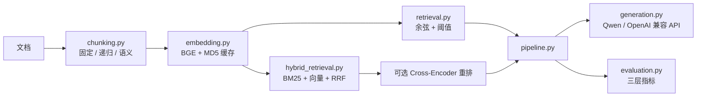

# rag-eval-platform 架构与设计决策

> 本文面向公开仓库读者，说明模块边界、数据流、评测口径与关键取舍。

## 1. 定位

一个可复现的 RAG 实验平台：把「切分 → 向量化 → 检索 → 生成 → 评测」拆成可独立替换的模块，
每个环节都能单独度量，并用对照实验回答问题——而不是只做一个「能问答」的 demo。

## 2. 模块图

## 3. 数据流

### 3.1 建库

1. `DocumentChunker` 按策略切分；分配**全局唯一** `chunk_index`（跨文档连续），文档内序号保留为 `doc_chunk_index`。
   —— 每个文档各自从 0 编号会造成跨文档索引重复，检索结果无法唯一标识。
2. `EmbeddingEngine` 用 BGE-small-zh-v1.5（512 维）编码；以文本 MD5 作为缓存键，内容不变不重算。
3. `RAGPipeline.build_index` 在 hybrid 模式下同步拟合 BM25 语料。

### 3.2 问答

1. query 编码；
2. 检索：
   - `vector`：余弦相似度 + `similarity_threshold` 过滤；
   - `hybrid`：向量全量排名 + BM25 排名 → RRF →（可选）Cross-Encoder 重排；
3. `GenerationEngine` 拼接 RAG Prompt 生成；
4. 返回 `answer` 与 `retrieved_docs`（含 `score` / `fusion_score` / `source` / `chunk_index`）。

### 3.3 评测

1. 检索层：文档级 Recall@3 / Recall@5 / Precision@3 / MRR；
2. 生成层：LLM-as-Judge（faithfulness / relevance / completeness）；
3. 传统层：BLEU / ROUGE-L。

## 4. 检索模式

### 4.1 纯向量（默认）

- embedding 已归一化，点积等价于余弦；
- 低于阈值的候选直接丢弃（宁可不答，不喂噪音）；
- 零额外依赖，几十~几百 chunk 规模下足够。

### 4.2 混合检索

- **BM25**：Okapi BM25，纯 NumPy 实现。分词 = 英文/数字整词 + 中文单字 + 中文二元组（不引入 jieba）。
- **融合**：RRF（Reciprocal Rank Fusion），`score = Σ 1/(k + rank)`，默认 `k=60`。
- **为什么不用加权求和**：向量余弦 ∈ [-1,1]，BM25 分数无上界，两者量纲不同，直接相加没有意义；
  RRF 只依赖排名，对分数量纲不敏感。
- **开关**：`retrieval.mode: "vector" | "hybrid"`，默认 `vector`，保持历史行为零回归。

### 4.3 重排（可选）

- 用 `CrossEncoder` 对 RRF 融合后的 top-N 做二次精排；
- 默认关闭：模型体积与下载成本；加载失败会自动降级回 RRF，不影响检索可用性。

## 5. 评测口径

### 5.1 为什么用文档级

chunk 边界随切分策略/参数变化，chunk 索引无法跨策略对照；
「是否检索到正确文档」才是策略无关的稳定口径。
实现上把 chunk 级结果按 `source` 去重（保留原相关性排序，不相关文档占位但不命中），
再复用同一套 Recall / Precision / MRR 公式。

### 5.2 三层指标

| 层 | 指标 | 回答的问题 |
|---|---|---|
| 检索 | Recall@3/5、Precision@3、MRR | 该找到的文档找到了吗？排得靠前吗？ |
| 生成 | faithfulness / relevance / completeness | 回答有依据吗？切题吗？完整吗？ |
| 传统 | BLEU / ROUGE-L | 与参考答案的字面重合度 |

## 6. 实验结果

### 6.1 混合检索对照（2026-10-18）

| 数据集 | 档位 | 平均 Recall@3 | 平均 MRR |
|---|---|---|---|
| realistic（14 篇，话题区分度大） | 纯向量 | 1.0 | 0.9286 |
| realistic | 混合 RRF | 1.0 | 0.9286 |
| near_dup_stress（10 篇，8 篇近义副本） | 纯向量 | 0.625 | 0.4792 |
| near_dup_stress | 混合 RRF | **1.0** | **0.7708** |

结论：混合检索的收益取决于语料。干净小库上强向量模型已接近上限，收益有限；
在含近义/重复文档的噪声语料上，BM25 的精确匹配能纠正向量把分数分散到副本的问题。

复现：`python experiments/run_hybrid_comparison.py`
（报告落 `experiments/results/hybrid_comparison_<date>.md`）。

### 6.2 切分策略对照（2026-10-16）

5 篇文档的样例集上，三种策略与各 chunk_size 的文档级 Recall@3 均为 1.0（数据集太小导致的天花板效应）；
报告见 `experiments/results/strategy_comparison_2026-10-16.md`，其中如实标注了适用边界。

## 7. 设计取舍

| 决策 | 理由 | 代价 / 边界 |
|---|---|---|
| NumPy 暴力余弦 | 小规模下复杂度不是瓶颈，零依赖、行为可解释 | 万级 chunk 需换 Faiss / 向量库 |
| RRF 而非加权求和 | 两路分数量纲不同 | 需要两路都有稳定排名 |
| 默认 `vector` | 保持历史行为零回归 | 用混合检索需显式配置 |
| 重排默认关 | 避免强制下载大模型 | 精度上限未完全释放 |
| 文档级评测 | 跨切分策略可比 | 不评价 chunk 内部定位精度 |

## 8. 扩展点

- 查询改写：HyDE / multi-query / step-back；
- 向量库：Faiss IVF+PQ / Chroma；
- 重排：`BAAI/bge-reranker-v2-m3`（中文效果好）；
- 生成评测：多次评分取中位数，降低 LLM-as-Judge 方差；
- 引用校验：答案句级 citation 与来源对齐。
